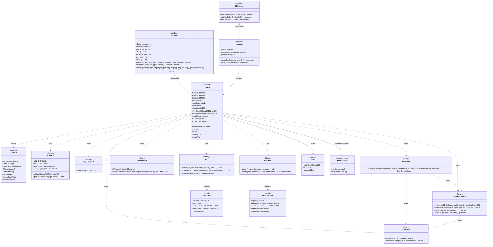

# Class diagram — AMM v3 Concentrated Liquidity

Structural view of contracts, libraries, and interfaces (module 14, **v1 design**).

## Diagram (Mermaid)

## Key relationships

| Relationship | Reason |
|--------------|--------|
| `CLFactory` → `CLPool` | One pool per `(token0, token1, fee)` |
| `CLPool` → math libs | Q64.96 price, amounts, and swap steps |
| `CLPool` → `TickBitmap` / `Tick` | Tick initialization and crossing |
| `CLPool` → `Position` | Liquidity and fees per `(owner, range)` |
| `SwapMath` → `SqrtPriceMath` | A step consumes/produces tokens up to the target |

## Design decisions (v1)

- No NFT Position Manager: positions indexed by `(owner, tickLower, tickUpper)`.
- Fee tiers with fixed `tickSpacing` via the factory (`enableFeeAmount`).
- `slot0` packs `sqrtPriceX96`, `tick`, and the lock (`unlocked`), Uniswap v3–style.
- Full flash swaps out of scope; `FlashSlippage` is reserved for compatibility with the module's error set.
- TWAP / observations: post-v1.

Spanish version: [`diagrama-de-clases-ES.md`](./diagrama-de-clases-ES.md)
