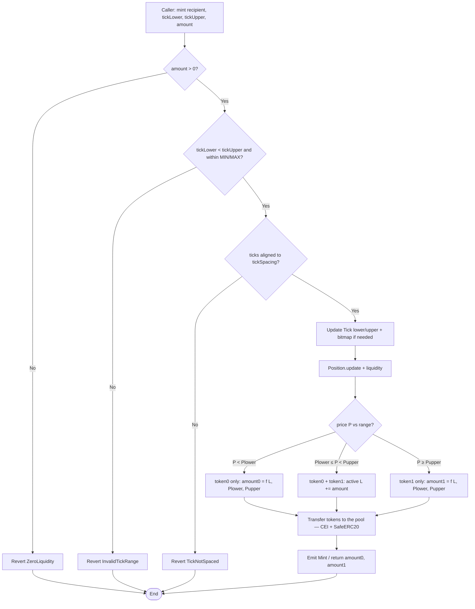
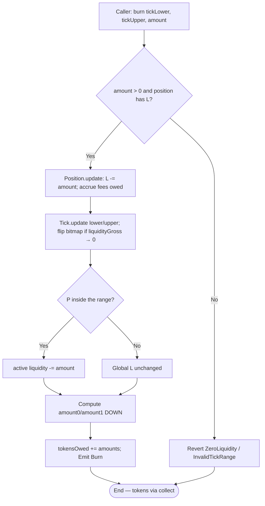
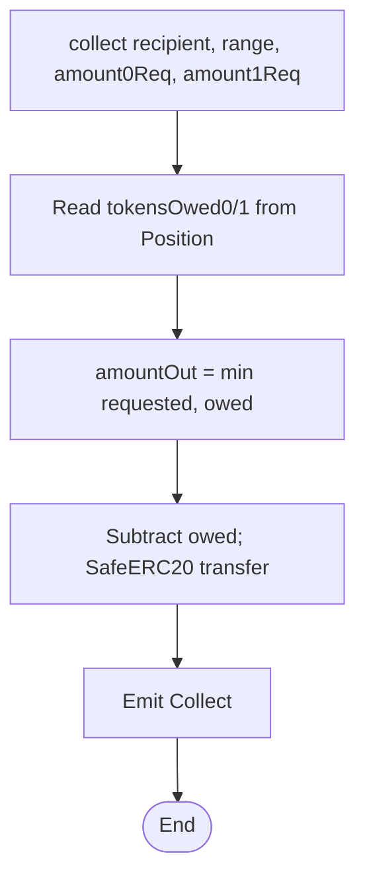
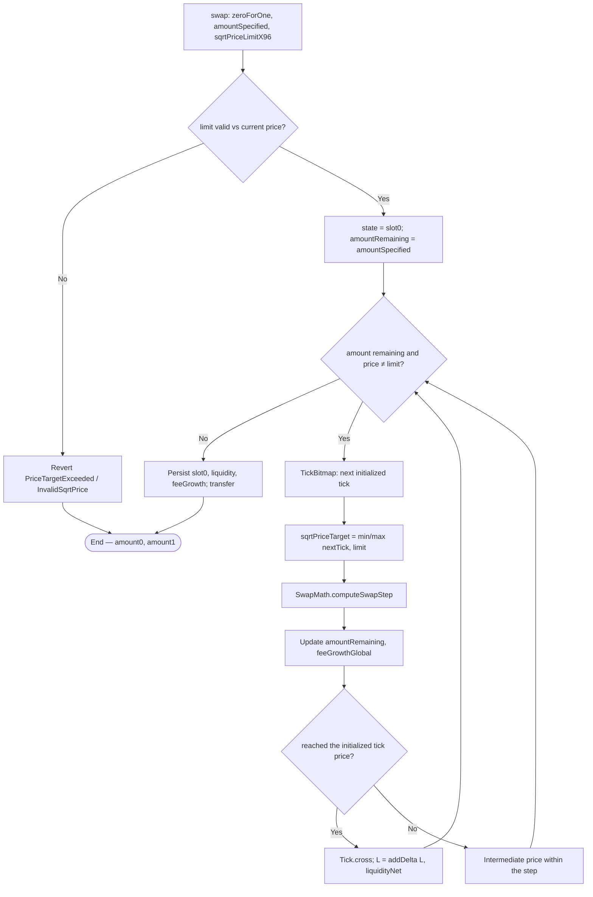
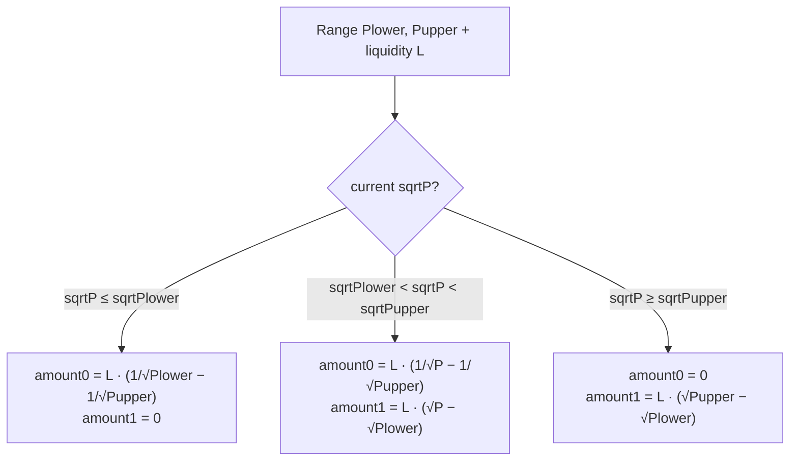
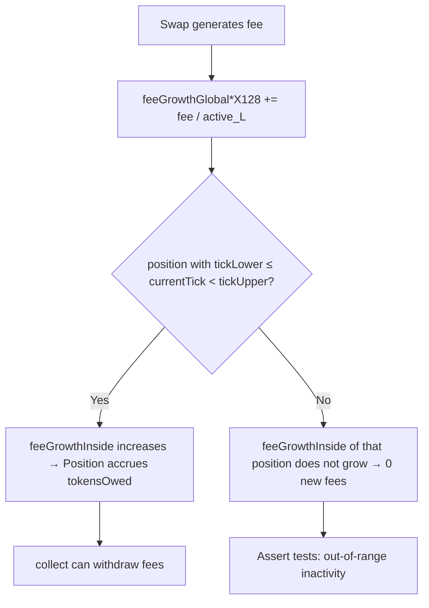
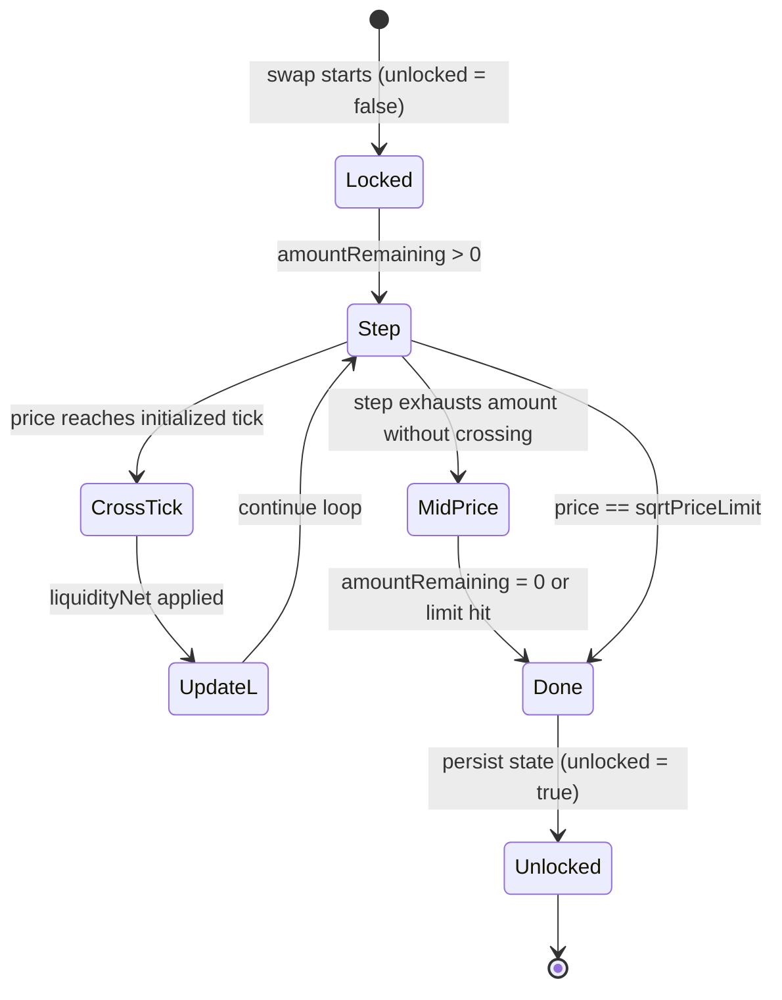
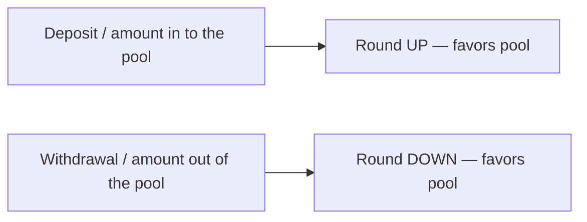

# Flow diagram — Mint, Burn, Swap, and Fees (CL AMM v3)

Internal decision flows of the concentrated liquidity pool (module 14, **v1 design**).

## 1. Mint — provide liquidity in a range

> Rounding: amounts computed **UP** (favors the pool).

## 2. Burn — withdraw liquidity

## 3. Collect — claim owed tokens / fees

## 4. Swap — multi-tick loop

## 5. Amount calculation by location of P

## 6. Fee growth — active vs out-of-range position

## 7. State cycle — slot0 during a swap

## 8. Cross-cutting rule — rounding

Spanish version: [`diagrama-de-flujo-ES.md`](./diagrama-de-flujo-ES.md)
