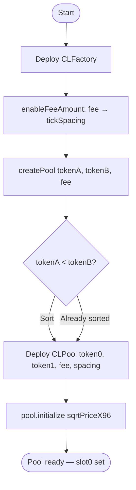
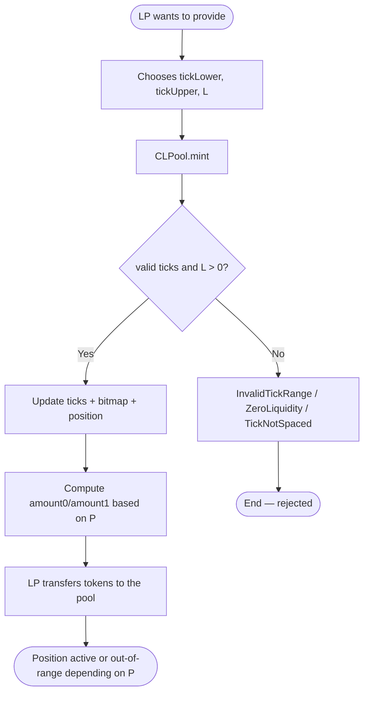
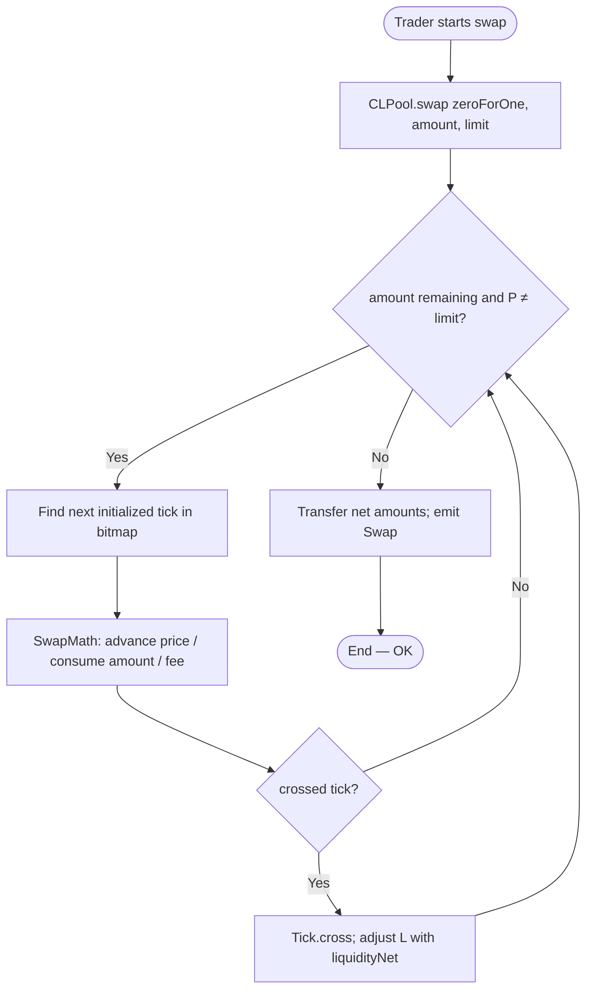
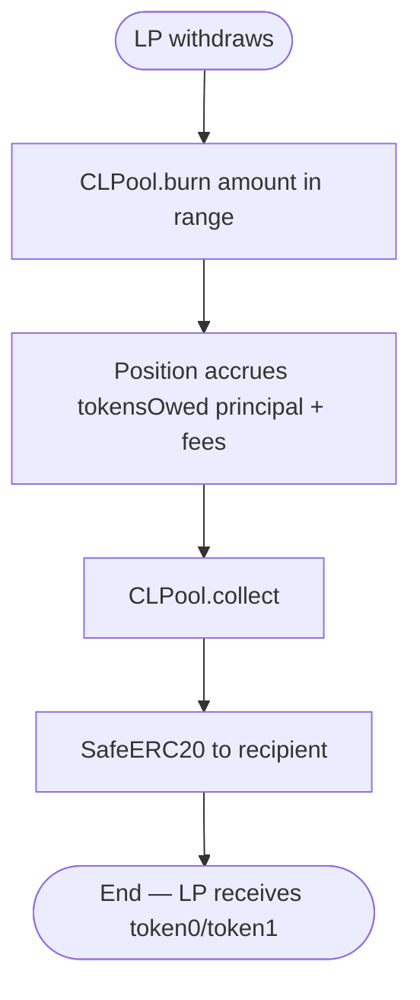
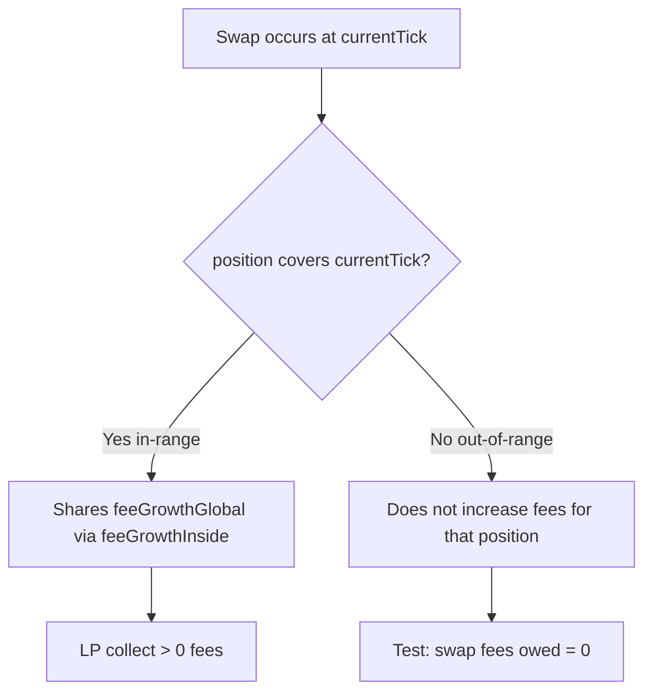
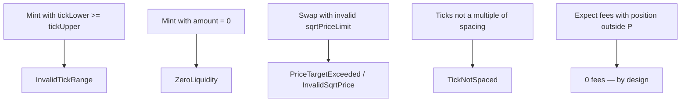
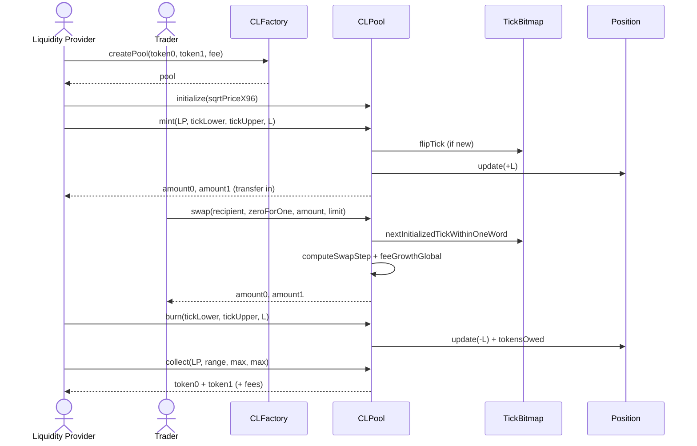
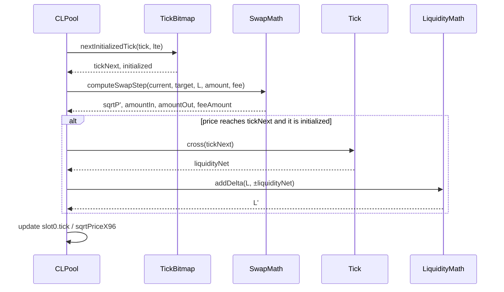

# End-to-end flowchart — AMM v3 Concentrated Liquidity full cycle

End-to-end flow between actors and contracts (module 14, **v1 design**): factory, mint, multi-tick swap, burn/collect, and testing.

## Actors

| Actor | Role |
|-------|------|
| Liquidity Provider (LP) | Provides liquidity in a tick range; collects fees |
| Trader / Swapper | Swaps token0 ↔ token1 against the pool |
| CLFactory | Creates and indexes pools by pair + fee |
| CLPool | Holds tokens, ticks, positions, and executes swaps |
| TickBitmap / Tick / Position | Internal liquidity and fee structures |
| CI / Foundry | Unit, fuzz, gas, out-of-range |

---

## Main flowchart — Deploy + createPool

---

## Main flowchart — Liquidity provision (mint)

---

## Main flowchart — Multi-tick swap

---

## Main flowchart — Burn + collect fees

---

## Flowchart — In-range vs out-of-range fees

---

## Flowchart — Typical attacks / misuse

---

## Sequence — happy path mint + swap + collect

---

## Sequence — a swap step that crosses a tick

---

## Implementation governance

```mermaid
flowchart LR
    Doc[doc/ ✅] --> F0[Phase 0 Setup ✅]
    F0 --> F1[Phase 1 FullMath/TickMath ✅]
    F1 --> F2[Phase 2 Sqrt/Liq/SwapMath ✅]
    F2 --> F3[Phase 3 Bitmap/Tick/Position ✅]
    F3 --> F4[Phase 4 Mint/Burn/Collect ✅]
    F4 --> F5[Phase 5 Multi-tick swap ✅]
    F5 --> F6[Phase 6 Factory/e2e/fuzz ✅]
    F6 --> F7[Phase 7 Gas/Deploy/SWC ✅]
    F7 --> Done([v1 module closed ✅])
```

**Gate:** do not move to the next phase without *“I authorize Phase N”*. Details in [`planificacion-EN.md`](./planificacion-EN.md).  
**Status:** Phases **0–7** ✅ (v1 module closed).

Spanish version: [`flujograma-ES.md`](./flujograma-ES.md)
